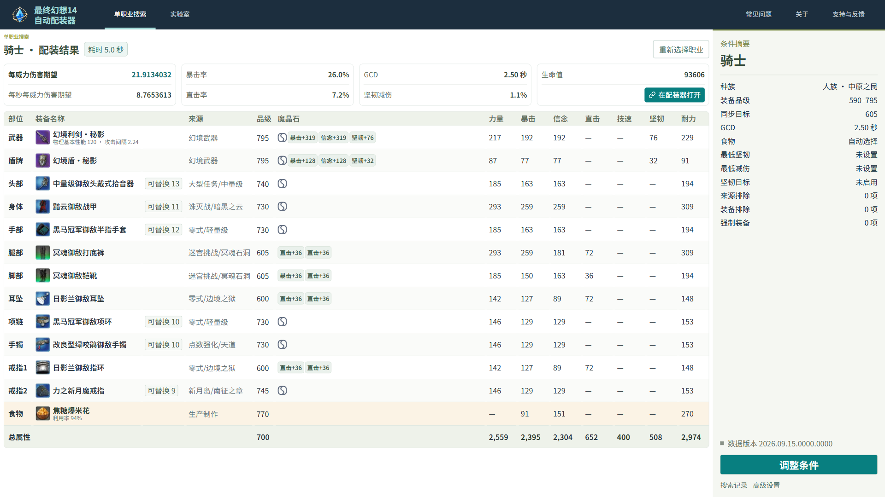
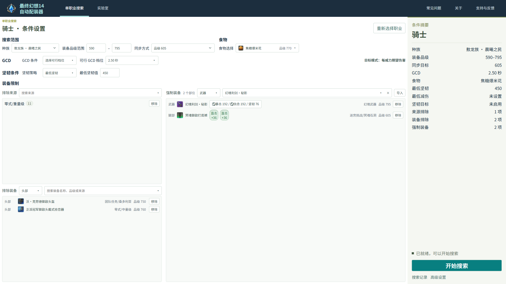
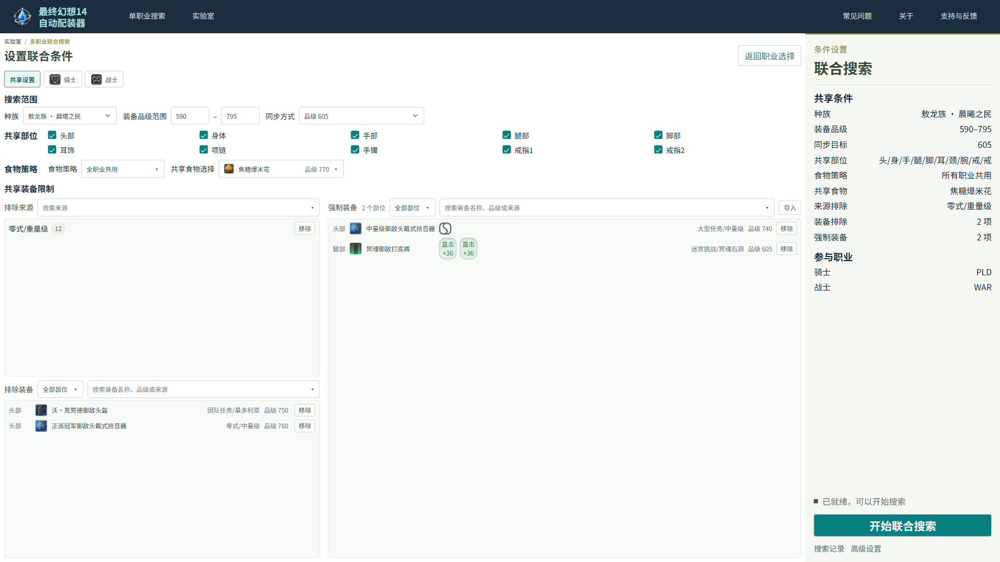

  

<h1 align="center">最终幻想14自动配装器</h1>

为你的职业自动寻找配装，兼顾多职业的装备共享。

  <a href="https://ffxiv-gear.yunshan.dev/"><strong>在线使用 · ffxiv-gear.yunshan.dev</strong></a>

  

一款在浏览器中运行的 FFXIV 自动配装工具。选择职业并设置装备范围、GCD 等条件，即可搜索装备、魔晶石与食物的搭配，减少手动比较配装的时间。计算在本地完成，无需安装或登录。

目前已开放使用，部分功能仍在开发。多职业联合搜索与装备对比可从「实验室」进入。

## 特色功能

- **单职业自动配装**：按装备品级、获取来源和 GCD 等条件寻找配装。可以排除不想使用的装备，或锁定已有装备、镶嵌与自定义参数，让工具优化其余部分。
- **多职业共享配装**：为同组职业一起规划装备与镶嵌。自行选择共享部位，分别设置各职业的 GCD 等条件，在多个职业之间寻找合适的共同方案。
- **同步配装**：支持按等级、品级或副本设置同步目标，为绝境战、幻巧战等场景寻找装备搭配。
- **查看结果**：查看完整装备、镶嵌、食物、总属性和伤害期望，可在 Asvel 配装器中打开方案，或点击「复制图片分享」将不含操作按钮的结果图片复制到剪贴板。同步单职业结果页提供「可替换」功能，可换用最终生效属性相同的装备，保持配装指标不变。

## 界面预览

配装结果：

更多截图

**单职业搜索**：设置装备范围、食物、GCD 和装备限制。

**多职业联合搜索**：选择共享部位与食物策略，通过职业标签分别设置条件。

## 使用说明

支持 20 个普通战斗职业，以及青魔法师、驯兽师；联合搜索目前开放普通战斗职业。具体数据版本请查看结果页。

建议在桌面浏览器中使用。搜索比较的是纸面伤害期望，未针对具体副本时间轴或职业循环调整，实际配装请结合自己的打法选择。

首次打开时会等待应用和游戏数据就绪；等待较久时显示加载提示。启动失败会停留在错误页，可查看详情并点击「重新加载」，本地搜索历史不会因此清空。

复杂条件下，尤其是多职业联合搜索，可能需要较长时间。搜索中可查看进度或随时取消。更多说明见[常见问题](https://ffxiv-gear.yunshan.dev/#/faq)。

## 反馈

[提交 Bug 或建议 → GitHub Issues](https://github.com/Yun-Shan/ffxiv-gearing-calc/issues/new/choose)

## 开发与致谢

开发与维护说明见[开发指南](docs/开发指南.md)。

感谢以下社区项目：

- [Asvel / ffxiv-gearing](https://github.com/Asvel/ffxiv-gearing)：配装、公式与数据参考。
- [Lumina](https://github.com/NotAdam/Lumina) / [EXDSchema](https://github.com/xivdev/EXDSchema) / [mcp-ffxiv-lumina](https://github.com/MelkyWay/mcp-ffxiv-lumina)：游戏数据读取、字段定义与 MCP 查询服务。
- [thewakingsands/xivapi-v2](https://github.com/thewakingsands/xivapi-v2)：装备与职业图标服务。
