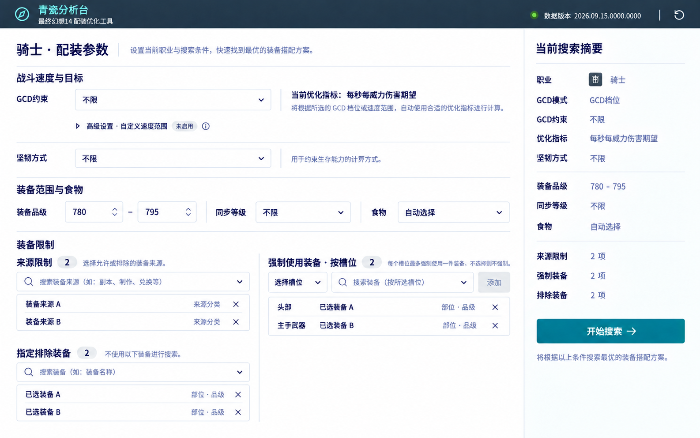
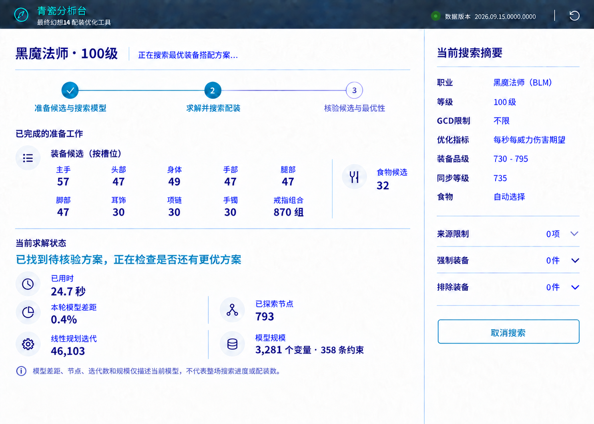

# 前端 UX 已确认方案

> 本文只记录当前已确认的设计决定。示意图仅用于说明结构，实际实现须沿用项目现有设计规范与真实领域数据。

## 适用范围与视觉规范

- 当前方案覆盖单职业配装流程，联合搜索暂不调整。
- 所有页面以 1440 × 695 为桌面验收视口；示意图尺寸仅用于说明结构。
- 页面沿用项目现有设计体系：深色顶栏、灰绿中性色、橄榄绿强调色、现有字体和控件。示意图中的蓝色文字、图标和其他生成样式不是视觉规范。

## 单职业参数页

### 页面结构

- 职业选择保持独立页面；其余搜索参数集中在连续工作台中。
- 参数页使用连续布局，不拆成多张独立卡片；右侧固定显示随条件更新的搜索摘要，底部保留唯一主操作“开始搜索”。
- 单职业不显示或提供职业等级选择，计算固定使用当前职业数据定义的最高等级；旧条件载入工作台后也使用该最高等级，历史结果仍保持原结果。
- 常用范围、同步等级和食物直接显示。搜索记录按单次搜索保存；用户可在流程第一步载入任意旧结果或条件，开始新搜索前不要求先比对旧条件。
- 参数主内容在 1440 × 695 视口内一屏呈现，不显示魔晶石规则；收起时搜索记录只占最底部一行，展开后允许页面滚动。右侧摘要占满页面可用高度。

### 指标与条件

- 指标由 GCD 条件自动决定：不限 GCD 或允许多个档位时使用“每秒每威力伤害期望”；只允许一个 GCD 档位时使用“每威力伤害期望”。
- 高阶自定义速度范围与 GCD 档位互斥，默认收起。自定义范围覆盖一个 GCD 档位时使用“每威力伤害期望”，覆盖多个档位时使用“每秒每威力伤害期望”；同时说明覆盖档位和自动采用的指标。
- 只为坦克职业显示坚韧条件，通过“坚韧方式”选择不限、最低坚韧值、最低减伤比例或候选范围内最高坚韧；仅显示所选方式对应的输入或说明。

### 装备限制

- 来源限制与指定排除装备放在左栏，使用可搜索的多选控件。已添加项从候选中隐藏，并作为可单独删除的列表行展示；装备名靠左，来源或槽位说明靠右。
- 强制装备放在右栏，通过“槽位 + 装备”添加；只显示已添加的槽位约束，不预先铺开所有槽位，并允许逐项删除。
- 列表按可用高度收缩；较长列表在列表内部滚动，优先保证主要参数和搜索摘要操作同屏可见。
- 来源限制、排除装备和强制装备均使用可搜索下拉列表：打开后默认列出候选项，输入仅筛选列表；有足够候选时至少同时显示 5 项。装备列表使用虚拟滚动。菜单脱离页面容器定位，不被页脚裁切，并根据触发位置和视口高度选择弹出方向与高度；触发位置过低时向上展开。

## 搜索进度页

### 页面结构与候选信息

- 搜索期间使用专注进度页。完整配置收起到右侧摘要，右侧保留“取消搜索”。
- 主区采用三阶段轨道：准备候选与搜索模型 → 求解并搜索配装 → 核验候选与最优性。当前阶段突出显示。
- 不显示整体进度估算条、百分比或剩余时间。求解器节点数和当前模型差距只表示当前模型的工作状态，不表示整场搜索完成比例。
- 准备区分成左右两栏：左侧是五列两行的装备槽位候选网格，槽位名在上、数量在下；槽位项没有卡片底色、边框或内边距，只留识别各项所需的最小间距。右侧在同一行单独显示食物候选数。
- 装备候选不合并成总数；戒指按实际搜索中的戒指组合数显示。BLM 实测示例：主手 57、头部 47、身体 49、手部 47、腿部 47、脚部 47、耳饰 30、项链 30、手镯 30、戒指组合 870 组；食物候选 32。

### 求解与核验信息

- 首个可行方案出现前显示“正在寻找可行配装”；出现后显示“已找到待核验方案，正在检查是否还有更优方案”。同时显示已用时。
- 默认展示当前模型差距、已探索节点、线性规划迭代数和模型规模（变量数、约束数）；多个 MIP 子模型依次运行时，明确这些指标对应当前模型。
- 只有上下界都是有限值且模型差距大于 0 时显示差距，百分比保留一位小数。差距为 0 或数据缺失时隐藏；收到 HiGHS Optimal 后显示模型已完成，不用 0% 表示完成。
- 节点数和线性规划迭代数收到合法非负整数时可显示，包括 0。模型建立后显示变量数和约束数。缺少回调数据时只显示已知状态和用时，不推算进度。
- 常规单轮核验只显示“正在核验候选方案”及最终核验/最优性状态，不显示核验计数。只有确实开始第二轮求解时，才显示已核验的候选组合数，并注明正在第几轮；该计数不是配装数量。
- 不展示内部代理目标、原始大整数、割池内容、原始解向量或回调次数。模型差距、节点、迭代数和模型规模旁说明它们只描述当前模型。

BLM 实测样例使用角色等级 100、不限制 GCD、同步品级 735、装备品级 730–795、默认食物。一次回调时点为已用时约 24.7 秒：模型差距 0.4%、已探索节点 793、线性规划迭代 46,103、模型规模 3,281 个变量和 358 条约束。该次搜索约 33.8 秒结束，运行一轮并证明最优；常规单轮界面不显示“已核验 1 组”。逐槽候选数来自同一配置的正式候选池逻辑。完整回调记录保留在 [BLM 实测回调日志](BLM-735-730-795-HIGHS-callbacks.jsonl)。

- 搜索摘要采用与结果页相同的条件展示规则。来源限制、强制装备和排除装备的详情默认收起；点击后从右侧向左弹出，点击其他位置自动收起，长列表只在浮层内部滚动。浮层详情可由键盘聚焦滚动，按 Esc 收起后焦点回到触发按钮。
- 点击“取消搜索”后立即停止，不弹确认框。
- 搜索进度页在 1440 × 695 视口内完整显示三阶段、当前有价值的真实回调信息和全高右侧摘要，不出现页面滚动。

## 完成结果页

### 页面结构

- 完成态隐藏四步进度条，保留“修改条件”入口。
- 推荐配装、逐件属性、食物、总属性和伤害/防御汇总在同一页面呈现。1440 × 695 验收视口内不让页面或装备表出现滚动。
- 采用装备表在左、汇总面板在右的结构；1440px 宽度初始按约 1060px 表格、320px 右侧面板分配，优先保证表格可读性，不额外预留大块两侧空白。
- 顶部保留目标值、搜索耗时和原有突出指标行（每威力伤害期望、GCD、暴击率、直击率、每秒每威力伤害期望）；不显示装备候选条目数或单职业基线比例。右侧摘要不重复顶部已有信息。
- 装备属性列按 4 个数字的宽度分配，装备名称列适当收窄，魔晶石列加宽到可容纳 5 项镶嵌信息；部位列须避免名称换行，品级列可收窄，属性标题与数值水平居中。食物行的属性、魔晶石说明、来源和品级必须与表头列对齐。

### 装备表与右侧摘要

- 装备表按装备逐行呈现当前职业适用的属性列、魔晶石、品级和独立的获取方式文字列；食物作为单独一行。逐件属性显示实际最终值，装备原生副属性达到单件上限时加粗。
- 获取方式使用真实来源文字；缺失时显示“上游未标注”，不得根据颜色推断。
- 右侧面板顺序为：结果身份（职业、搜索时间、数据版本）→ 配装总属性 → 未在顶部重复的伤害/防御数据 → 完整搜索条件。属性名称使用项目中文映射。
- 来源限制、强制装备和排除装备的详情默认收起；点击后从右侧向左弹出浮层，点击其他位置收起。列表较长时只在浮层内部滚动；键盘可聚焦并滚动详情列表，按 Esc 收起后焦点回到触发按钮。
